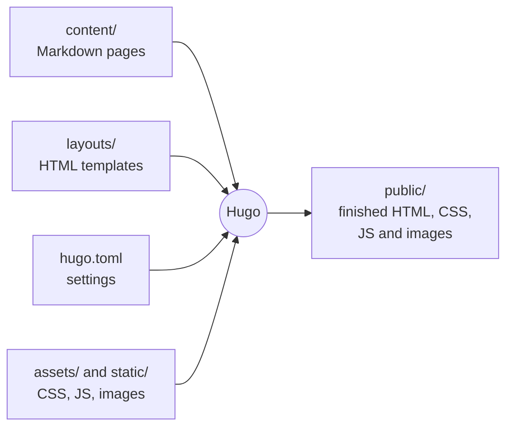
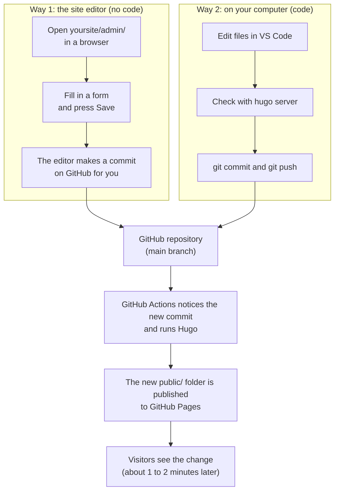

# 1. How the website works

**You'll learn:** what happens when someone visits our site, what a "static site" is, what Hugo does, and the path a change takes from your keyboard to the internet.

## What happens when you visit a website

When you type an address into a browser, the browser asks a computer somewhere (a **server**) for a file. The server sends back an **HTML** file, which describes the page's text and structure. The HTML tells the browser to fetch more files: **CSS** (how it looks), **JavaScript** (what it does when you click), images and fonts. The browser puts all of that together and draws the page.

That's true of every website. What's different between websites is *how the server gets the HTML*.

## Two ways to make HTML: dynamic and static

**Dynamic sites** build each page at the moment someone asks for it. WordPress, for example, runs a program on the server that reads from a database and assembles the HTML on every visit. That needs a server running all the time, a database, security updates, and usually money.

**Static sites** build every page *ahead of time*. A program reads our content and templates once, writes out a finished HTML file for every page, and those files are uploaded to a simple file host. When you visit, the host just hands over a file that already exists.

| | Dynamic (e.g. WordPress) | Static (our site) |
| --- | --- | --- |
| When pages are built | On every visit | Once, whenever something changes |
| Needs a database | Yes | No |
| Needs a program running on the server | Yes | No |
| Cost to host | Usually paid | Free (GitHub Pages) |
| Speed | Slower | Very fast: just files |
| Security | Needs updates, can be hacked | Almost nothing to attack |
| Content can change by itself | Yes (comments, logins) | No: only when we rebuild |

The last row is the trade-off. A static site can't do things like let visitors log in or receive form submissions by itself. For a team website that's fine: we use a form service for the contact form (see [chapter 11](11-site-editor.md#contact-forms)) and we rebuild the site whenever we change something.

## What Hugo does

[Hugo](https://gohugo.io/) is a **static site generator**: the program that builds all those HTML files. You give it three things:

1. **Content**: what each page says, written in Markdown files (the `content/` folder)
2. **Templates**: how pages are laid out, written in HTML with special `{{ }}` instructions (the `themes/ver37974/layouts/` folder)
3. **Settings**: the site's name, menus and options (`hugo.toml`)

Hugo combines them and writes a complete website into a folder called `public/`.

Think of it like a mail merge. The template is the letter with blanks ("Dear ___"), the content fills in the blanks, and Hugo prints one finished letter per page.

## What a theme is

A **theme** is a package of templates, CSS, JavaScript and images that decides how the site looks. Ours is called `ver37974` and lives in `themes/ver37974/`. Keeping it separate from the content means:

- People writing content don't need to touch the theme
- People working on the theme can test it with any content
- You could, in theory, swap in a different theme without rewriting a single page

## Where the files live: GitHub

All of the site's files are stored in a **Git repository** on **GitHub**. Git is a tool that keeps the full history of every file, so you can see who changed what and when, and undo anything. GitHub is a website that hosts Git repositories so everyone on the team can work on the same files.

Every saved change in Git is called a **commit**. Each commit has a message describing it, like "Add Edmonton qualifier results".

## From your keyboard to the internet

There are two ways to change the site, and they end up in the same place.

The important idea: **the website is just the output.** The real thing is the repository. If the website disappeared tomorrow, we could rebuild it exactly from the repository in a minute.

## Why we chose this setup

- **It's free.** GitHub hosts both the files and the website.
- **Nothing to hack or update.** There's no server program or database.
- **Every change is recorded.** If someone posts something by mistake, we can see exactly what changed and undo it.
- **You learn real tools.** Git, HTML, CSS, Markdown and command-line tools are used by professional software teams everywhere.

## Check your understanding

1. What's the difference between a static site and a dynamic site?
2. What three things does Hugo combine to build the site?
3. Where does Hugo put the finished website?
4. If you fix a typo using the site editor, what happens before visitors see the fix?
5. Why can't our site receive a contact form submission by itself?

Answers

1. A static site's pages are built ahead of time and served as finished files. A dynamic site builds each page when someone asks for it, using a program and usually a database on the server.
2. Content (Markdown in `content/`), templates (`layouts/`), and settings (`hugo.toml`). Assets like CSS and images are used too.
3. In the `public/` folder.
4. The editor makes a commit on GitHub. GitHub Actions sees the commit, runs Hugo to rebuild the site, and publishes the new `public/` folder to GitHub Pages. That takes a minute or two.
5. Receiving a form submission needs a program running on a server to accept and store or forward it. A static site only serves files, so we use a separate form service.

Next: [2. Setting up your computer](02-setting-up-your-computer.md)
