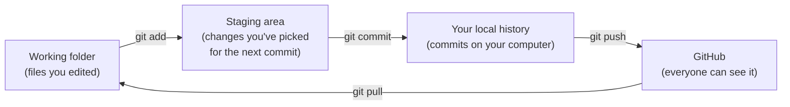

# 2. Setting up your computer

**You'll learn:** how to install the tools, get a copy of the site, run it on your own computer, make a change, and send it back to GitHub using Git.

You only need this chapter if you're going to edit code. If you only post content, the [site editor](11-site-editor.md) works in any browser with nothing to install.

## The tools

| Tool | What it does | Why we need it |
| --- | --- | --- |
| **Git** | Tracks every change to every file | So we have history and can undo, and so several people can work at once |
| **Hugo (extended edition)** | Builds the website | It turns our content and templates into HTML. The *extended* edition can convert images to WebP |
| **VS Code** | A code editor | Colour-coded editing, a built-in terminal and Git tools |
| **A GitHub account** | Access to the repository | Ask the website lead to add you as a collaborator |

### Install them

**Windows** (open *PowerShell*):

```powershell
winget install Git.Git
winget install Hugo.Hugo.Extended
winget install Microsoft.VisualStudioCode
```

**macOS** (install [Homebrew](https://brew.sh/) first, then in *Terminal*):

```sh
brew install git hugo
brew install --cask visual-studio-code
```

**Linux or ChromeOS (Linux enabled):** install Git with your package manager. For Hugo, download the `hugo_extended` file for your system from the [Hugo releases page](https://github.com/gohugoio/hugo/releases). Our site needs version 0.146 or newer.

Check that it worked. Close and reopen your terminal, then run:

```sh
git --version
hugo version
```

`hugo version` should mention `+extended`. If it says "command not found", see [Troubleshooting](14-troubleshooting.md#hugo-command-not-found).

### Useful VS Code extensions

Open the Extensions panel (the four squares icon) and install:

- **Hugo Language and Syntax Support**: colours the `{{ }}` template code
- **YAML** (by Red Hat): catches mistakes in front matter and `config.yml`
- **Even Better TOML**: for `hugo.toml`
- **Code Spell Checker**: catches typos before visitors do

### Tell Git who you are

Git puts your name on each commit. Use your first name and the email on your GitHub account:

```sh
git config --global user.name "Avery"
git config --global user.email "you@example.com"
```

## Get a copy of the site

"Cloning" downloads the repository, including its full history:

```sh
git clone https://github.com/YOUR-ACCOUNT/YOUR-REPO.git
cd YOUR-REPO
code .
```

The last line opens the folder in VS Code. From now on, use VS Code's built-in terminal (**Terminal > New Terminal**) so you're always in the right folder.

## Run the site on your computer

```sh
hugo server
```

You'll see something like:

```text
Web Server is available at http://localhost:1313/ (bind address 127.0.0.1)
Press Ctrl+C to stop
```

Open http://localhost:1313 in your browser. This is the whole website, running on your computer only. Nobody else can see it.

`hugo server` keeps watching your files. **When you save a file, the browser reloads by itself.** That's called *live reload*, and it's how you'll work most of the time: change, save, look.

To stop it, click in the terminal and press **Ctrl+C**.

> **What's different from the real site?** `hugo server` uses `localhost` instead of our real address, and adds a small live-reload script to every page. Otherwise it's identical. It writes the pages into a `public/` folder, so don't be surprised when one appears. Git ignores it.

## Your first change

1. Start `hugo server` and open the home page.
2. In VS Code, open `content/_index.md`.
3. Find the line `title: Every robot is a new version.` (under `hero:`) and change the words.
4. Save (**Ctrl+S**, or **Cmd+S** on a Mac).
5. Look at the browser. The headline has changed.

Now break it on purpose. Delete the two spaces in front of that `title:` so it lines up with `hero:`, and save. The terminal (and the browser) show an error like this:

```text
"content/_index.md:6:1": [5:1] mapping key "title" already defined at [1:1]
```

Read it piece by piece: the problem is in `content/_index.md` around line 6, and the key `title` was already defined on line 1. Without the indentation, YAML thinks this `title` belongs to the page itself rather than to `hero`, and the page already has a title on line 1. Indentation is how YAML knows what belongs inside what (more in [chapter 4](04-content.md)). Put the spaces back and the error disappears.

## Saving your work with Git

Git has three places your changes can be:



The everyday commands:

```sh
git status                 # What have I changed?
git diff                   # Show me the exact lines I changed
git add content/_index.md  # Pick this file for the next commit
git commit -m "Reword the home page headline"
git push                   # Send my commits to GitHub
git pull                   # Get everyone else's commits
```

VS Code's **Source Control** panel (the branching icon) does the same things with buttons. Use whichever you like, but learn what the commands mean.

**Good commit messages** say what changed and, if it isn't obvious, why. "Fix typo in sponsor page" is good. "stuff" or "changes" is not. In six months someone will read your message trying to work out why the site broke.

### Always pull before you start

The site editor commits straight to GitHub. If a coach posted an announcement while you were working, GitHub has a commit you don't. **Run `git pull` every time you sit down to work**, before you change anything. If you forget, `git push` will be refused with a message about the remote containing work you don't have. Run `git pull`, then `git push` again.

## Branches and pull requests (for anything bigger than a typo)

The `main` branch is the live website: every commit to it is published within minutes. For anything that could break the site, like a template or CSS change, work on a **branch** and open a **pull request** so someone else can check it first.

```sh
git switch -c add-awards-page      # Make a new branch and move to it
# ...edit, save, check with hugo server...
git add .
git commit -m "Add awards page"
git push -u origin add-awards-page # Send the branch to GitHub
```

Then on GitHub, click **Compare & pull request**. Describe what you changed and how you tested it. A reviewer (the website lead or a mentor) reads it, asks questions, and merges it into `main` when it's ready. Our checks workflow also builds the site for every pull request, so if your change breaks the build, you'll see a red ✗ before anything goes live ([chapter 12](12-publishing.md)).

When it's merged, go back to `main` and get the latest:

```sh
git switch main
git pull
```

## Check your understanding

1. What does `hugo server` do that `hugo` doesn't?
2. You edited three files but only want to commit one of them. Which command picks just that one?
3. Why should you run `git pull` before you start working?
4. When should you use a branch and pull request instead of committing to `main`?

<details>
<summary>Answers</summary>

1. `hugo server` also runs a local web server, keeps watching your files, rebuilds when you save, and reloads the browser. Plain `hugo` builds the site once into `public/` and stops.
2. `git add path/to/that-file`, then `git commit`.
3. Because other people, and the site editor, may have committed changes to GitHub since you last pulled. Pulling first avoids conflicts and refused pushes.
4. For anything that could break the site or that someone should review: template, CSS, JavaScript, config or editor changes. Small content fixes can go straight to `main`.

</details>

Next: [3. A tour of the project](03-project-tour.md)
