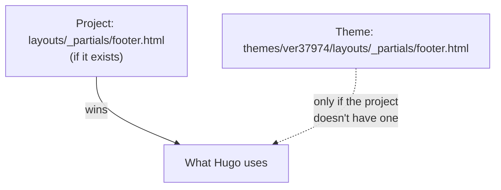

# 3. A tour of the project

**You'll learn:** what every folder and file in the repository is for, and the one rule that decides which file Hugo uses when two have the same name.

Keep this chapter open while you explore. Open each file as you read about it.

## The big picture

```text
your-repo/
├── hugo.toml              ← site settings: name, menus, emails, options
├── content/               ← what the pages SAY (Markdown)
├── data/                  ← structured data used by templates (YAML)
├── assets/                ← site images that Hugo processes (resizes, converts)
├── static/                ← files copied to the site exactly as they are
│   └── admin/             ← the site editor
├── archetypes/            ← starter templates for new content files
├── themes/
│   └── ver37974/          ← how the pages LOOK (our theme)
│       ├── layouts/       ← HTML templates
│       ├── assets/        ← the theme's CSS and JavaScript
│       └── static/        ← the theme's logo, icons and fonts
├── .github/workflows/     ← instructions for GitHub's robots (build and publish)
├── docs/                  ← this guide
└── README.md              ← the quick-start page you see on GitHub
```

Two folders appear after you build, and are never committed (they're listed in `.gitignore`):

- `public/`: the finished website. Hugo writes it every time you run `hugo`.
- `resources/_gen/`: Hugo's cache of resized images, so it doesn't redo them every build.

## The one rule: your project beats the theme

The project folder and the theme folder have the same layout: both have `layouts/`, `assets/` and `static/`. Hugo stacks them, with the project on top. **If the same path exists in both, the project's file wins.**



This lets you change any part of the theme without editing the theme itself: copy the theme file to the same path in the project, and edit the copy. [Recipe 7](13-recipes.md#recipe-7-override-a-theme-file-without-editing-the-theme) walks through it.

## Every file, explained

### Settings and project files

| File | What it does |
| --- | --- |
| `hugo.toml` | Site settings in [TOML](15-glossary.md#toml) format. `baseURL` (the site's address), `theme` (which theme to use), `[params]` (team name, emails, social links, form address), `[menus]` (navigation), `[[cascade]]` (members and sponsors don't get their own pages), and image quality settings. Templates read `[params]` as `site.Params`. |
| `README.md` | The front page of the repository on GitHub: setup, deployment and the go-live checklist. |
| `.gitignore` | Files Git should never commit: `public/`, `resources/_gen/` and Hugo's lock file. |
| `.github/workflows/deploy.yml` | Tells GitHub Actions to build the site and publish it on every push to `main`, and once a day. See [chapter 12](12-publishing.md). |
| `.github/workflows/check.yml` | Builds the site for every pull request, to catch mistakes before they go live. |

### `content/`: what the pages say

Each folder is a **section** of the site, and becomes a part of the address. `content/blog/welcome.md` becomes `/blog/welcome/`.

| Path | Becomes | Notes |
| --- | --- | --- |
| `content/_index.md` | `/` (home page) | The home page's headline, intro, buttons and "what we do" items |
| `content/about/_index.md` | `/about/` | Who we are (the Markdown body), plus facts, values and roles in front matter |
| `content/members/_index.md` | `/members/` | The intro text and the order of subteam filter buttons |
| `content/members/*.md` | (no page of their own) | One file per person. Shown on `/members/` |
| `content/robot/_index.md` | `/robot/` | Intro for the robot section |
| `content/robot/2026-27.md` | `/robot/2026-27/` | One season: specs, the version history, results |
| `content/portfolio/*.md` | `/portfolio/<name>/` | Engineering journal entries |
| `content/outreach/*.md` | `/outreach/<name>/` | Outreach events, with hours and people reached |
| `content/events/*.md` | `/events/<name>/` | Competitions and team events |
| `content/gallery/<album>/index.md` | `/gallery/<album>/` | One folder per album. The photos sit in the same folder |
| `content/sponsors/*.md` | (no page of their own) | One file per sponsor. Shown on `/sponsors/` and the home page |
| `content/sponsor-us/_index.md` | `/sponsor-us/` | Why sponsor, and the text beside the sponsor form |
| `content/blog/*.md` | `/blog/<name>/` | Blog posts |
| `content/announcements/*.md` | `/announcements/<name>/` | Announcements |

Notice two kinds of file names:

- **`_index.md`** (with an underscore) is the page *for a section itself*, like the list at `/blog/`.
- **`index.md`** (no underscore) inside a folder makes that folder a single page that can hold its own files, like a gallery album with its photos. This is called a **page bundle**.

[Chapter 4](04-content.md) explains both in detail.

### `data/`

| File | What it does |
| --- | --- |
| `data/sponsorship.yaml` | The sponsorship tiers, the season budget, in-kind ideas, the "how to sponsor" steps and the sponsor banner text. Templates read it as `site.Data.sponsorship`. It's data, not a page, because several pages use it. |

### `assets/` (project level)

| Path | What it does |
| --- | --- |
| `assets/images/uploads/` | Images uploaded through the site editor: blog covers, robot photos, sponsor logos. Hugo only publishes an image from here when a page uses it, and makes resized WebP copies. See [chapter 10](10-images-and-assets.md). |

### `static/` (project level)

Everything in `static/` is copied to the finished site unchanged. `static/admin/index.html` becomes `/admin/index.html`.

| File | What it does |
| --- | --- |
| `static/admin/index.html` | The page that loads the site editor app. |
| `static/admin/config.yml` | Tells the editor where the repository is, what kinds of content exist, and which form fields each kind has. See [chapter 11](11-site-editor.md). |

### `archetypes/`

Starter files used by `hugo new content`. Running `hugo new content events/regional.md` copies `archetypes/events.md`, fills in the title and date, and saves it as `content/events/regional.md`.

| File | Used for |
| --- | --- |
| `archetypes/default.md` | Any section without its own archetype (blog posts, outreach) |
| `archetypes/announcements.md` | Announcements |
| `archetypes/events.md` | Events |
| `archetypes/members.md` | Members |
| `archetypes/portfolio.md` | Journal entries, with the Goal / What we tried / Results / Decision / Next steps headings |

### `themes/ver37974/`: the theme

| File | What it does |
| --- | --- |
| `theme.toml` | The theme's name, description and minimum Hugo version. Information only. |
| `assets/css/main.css` | All the styles: colours, fonts, layout, every component. [Chapter 8](08-css.md). |
| `assets/js/main.js` | All the JavaScript: mobile menu, drop-downs, filters, photo viewer, videos. [Chapter 9](09-javascript.md). |
| `static/images/logo.png` | The logo with a transparent background, used in the header and footer. |
| `static/images/logo-512.png` | A larger logo for the home page. |
| `static/images/logo-on-navy.png` | The original square logo on navy. |
| `static/images/favicon-32.png`, `icon-192.png`, `apple-touch-icon.png` | Browser tab and phone home-screen icons. |
| `static/images/og-default.png` | The picture shown when someone shares a link to the site, if the page has no cover image. |
| `static/fonts/*.woff2` | The two typefaces, stored with the site so visitors' browsers never contact a font service. The `OFL-*.txt` files are their licences. |

#### `themes/ver37974/layouts/`: the templates

[Chapter 5](05-how-hugo-builds-a-page.md) explains how Hugo picks which template to use. Here's what each one does.

**Page templates** (one of these renders each page):

| Template | Renders |
| --- | --- |
| `baseof.html` | The outer shell of *every* page: `<html>`, `<head>`, header, footer, script. Every other page template fills in its `main` block. |
| `home.html` | The home page. |
| `list.html` | Any section page that doesn't have its own template. Currently: the blog list. |
| `single.html` | Any single page that doesn't have its own template. Currently: blog posts and announcements. |
| `taxonomy.html` | The list of all tags at `/tags/`. |
| `term.html` | One tag's page, like `/tags/robot/`. |
| `404.html` | The "page not found" page. |
| `about/list.html` | The About page. |
| `members/list.html` | The Members page. |
| `robot/list.html` | The Robot page: the current season, then past seasons. |
| `robot/single.html` | One season, with its version history and results. |
| `portfolio/list.html` | The engineering portfolio list, with subsystem filters. |
| `portfolio/single.html` | One journal entry. |
| `outreach/list.html` | Outreach list, with totals. |
| `outreach/single.html` | One outreach event. |
| `events/list.html` | Events, split into "Coming up" and "Past events". |
| `events/single.html` | One event. |
| `gallery/list.html` | All albums. |
| `gallery/single.html` | One album: photo grid, photo viewer and videos. |
| `sponsors/list.html` | Our sponsors, grouped by tier. |
| `sponsor-us/list.html` | The Become a sponsor page. |
| `announcements/list.html` | Announcements, with pinned ones first. |

**Partials** (`_partials/`): reusable pieces that page templates include.

| Partial | What it does |
| --- | --- |
| `head.html` | Everything inside `<head>`: page title, description, icons, sharing preview, and the CSS link. |
| `header.html` | The top bar: logo, menu with drop-downs, and the gold button. |
| `footer.html` | The bottom of every page: logo, social links, footer menu, contact, legal text. |
| `social.html` | The row of round social media icons. |
| `page-head.html` | The big title area at the top of most pages, with an optional "Back to" link and date line. |
| `post-card.html` | A card with image, date, title and summary. Used for blog posts. |
| `announcement-row.html` | One row in the announcements list. |
| `event-row.html` | One row in the events list, with the big date. |
| `member-card.html` | One member: photo or initial, name, role, subteams. |
| `season-summary.html` | A season's photo, summary and specs. Used on the Robot page and season pages. |
| `sponsor-logo.html` | One sponsor's logo on a white tile, or their name if there's no logo. |
| `cta-band.html` | The "Help us build the next version" sponsor banner. |
| `contact-form.html` | The contact form, or an email link if no form service is set. |
| `pager.html` | "Newer / Older" links when a list has more than one page. |
| `post-nav.html` | Links to the previous and next post at the bottom of a post. |
| `date.html` | Formats a date like "October 19, 2026". |
| `img.html` | Outputs a resized, responsive `` tag. |
| `image-resolve.html` | Finds an image file from a path, so `img.html` can resize it. Returns a value instead of HTML. |
| `image-processable.html` | Says whether an image can be resized (photos and PNGs can; SVG drawings and GIFs can't). Returns `true` or `false`. |
| `link.html` | Turns `/about/` into a link that works even if the site lives in a sub-folder. Returns a value. |
| `upcoming-events.html` | Works out which events haven't happened yet, soonest first. Returns a value. |
| `current-season.html` | Finds the current robot season. Returns a value. |
| `sponsors-sorted.html` | Lists active sponsors in tier order. Returns a value. |

**Render hooks** (`_markup/`): these change how Hugo turns Markdown into HTML.

| Hook | What it does |
| --- | --- |
| `render-image.html` | Every `` in Markdown goes through here, so images in posts get resized too. |
| `render-link.html` | Every `[text](/link/)` in Markdown goes through here, so links work in a sub-folder and outside links get `rel="noopener"`. |

## Try it

1. Open `content/blog/welcome.md` and `themes/ver37974/layouts/single.html` side by side (right-click a tab, **Split Right**). Find where the post's `title` from the first file appears in the second.
2. Run `hugo` (not `hugo server`), then open the `public/` folder. Find `public/blog/welcome/index.html` and open it in VS Code. That's exactly what visitors download. Delete `public/` afterwards, or leave it: Git ignores it.
3. Find the file that controls the text "Help us build the next version". (Hint: it's not in `content/`.)

## Check your understanding

1. You want to change the team's email address everywhere on the site. Which file?
2. What's the difference between `content/blog/_index.md` and `content/gallery/2026-season-kickoff/index.md`?
3. The theme has `layouts/_partials/footer.html`. You create `layouts/_partials/footer.html` in the project. Which one does Hugo use?
4. Why isn't `public/` committed to Git?

<details>
<summary>Answers</summary>

1. `hugo.toml`, under `[params]` (`email` and `sponsorEmail`).
2. `_index.md` is the content for the section's own list page (`/blog/`). `index.md` makes the album folder a single page (a page bundle) that keeps its photos in the same folder.
3. The project's. Project files override theme files at the same path.
4. It's generated from the other files every time Hugo builds. Committing it would mean storing two copies of everything and keeping them in sync by hand. GitHub Actions builds a fresh one on every deploy.

</details>

Next: [4. Content: Markdown and front matter](04-content.md)
