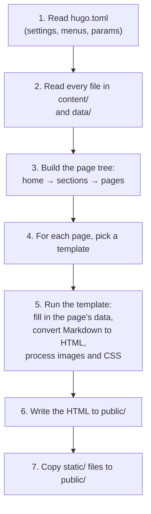

# 5. How Hugo builds a page

**You'll learn:** what Hugo does, step by step, when it builds the site; the five kinds of pages; how Hugo decides which template renders which page; and how `baseof.html` wraps every page.

## What happens when you run `hugo`



Steps 4 and 5 are where the theme comes in. The rest of this chapter is about them.

## The five kinds of page

Every page Hugo builds is one of five **kinds**. Templates can check which one they're on with `.Kind`.

| Kind | What it is | Examples on our site |
| --- | --- | --- |
| `home` | The home page | `/` |
| `section` | A section's list page, from its `_index.md` | `/blog/`, `/events/`, `/about/`, `/sponsor-us/` |
| `page` | A single page, from a regular `.md` file or a bundle's `index.md` | `/blog/welcome/`, `/gallery/2026-season-kickoff/` |
| `taxonomy` | The list of all terms in a grouping | `/tags/` |
| `term` | Everything with one term | `/tags/robot/` |

Notice that About and Become a sponsor are **sections** even though they don't list anything. Making them sections (`about/_index.md`) let us give each its own template folder, like `layouts/about/list.html`.

## Which template renders which page

For each page, Hugo looks through a list of possible template files and uses the first one that exists. Roughly:

1. Is there a template in a folder named after the page's **section**? (`layouts/events/single.html` for an event page)
2. If not, use the general one. (`layouts/single.html`)

Templates are matched by kind:

| Page kind | Template names Hugo looks for |
| --- | --- |
| `home` | `home.html`, then `list.html` |
| `section` | `section.html`, then `list.html`, first in the section's folder, then at the top of `layouts/` |
| `page` | `page.html`, then `single.html`, first in the section's folder, then at the top |
| `taxonomy` | `taxonomy.html`, then `list.html` |
| `term` | `term.html`, then `list.html` |

Here's the result for our site. We checked this with `hugo --templateMetrics`, which lists every template Hugo used and how many times:

| Page | Kind | Template used |
| --- | --- | --- |
| `/` | home | `home.html` |
| `/about/` | section | `about/list.html` |
| `/members/` | section | `members/list.html` |
| `/robot/` | section | `robot/list.html` |
| `/robot/2026-27/` | page | `robot/single.html` |
| `/portfolio/` | section | `portfolio/list.html` |
| `/portfolio/choosing-a-drivetrain/` | page | `portfolio/single.html` |
| `/outreach/`, `/outreach/library-demo/` | section, page | `outreach/list.html`, `outreach/single.html` |
| `/events/`, `/events/qualifier/` | section, page | `events/list.html`, `events/single.html` |
| `/gallery/`, `/gallery/2026-season-kickoff/` | section, page | `gallery/list.html`, `gallery/single.html` |
| `/sponsors/` | section | `sponsors/list.html` |
| `/sponsor-us/` | section | `sponsor-us/list.html` |
| `/announcements/` | section | `announcements/list.html` |
| `/announcements/forms-due/` | page | `single.html` (no `announcements/single.html`, so the general one) |
| `/blog/` | section | `list.html` (no `blog/list.html`) |
| `/blog/welcome/` | page | `single.html` |
| `/tags/` | taxonomy | `taxonomy.html` |
| `/tags/robot/` | term | `term.html` |
| Any missing page | | `404.html` |

Run it yourself:

```sh
hugo --templateMetrics
```

You'll get a table with a `count` column. `single.html` has a count of 6: three blog posts and three announcements.

> **Remember the override rule from chapter 3.** At every step, Hugo checks your project's `layouts/` folder before the theme's. So you could make blog posts look different by creating `layouts/blog/single.html` in the project, without touching the theme.

## `baseof.html`: the shell around every page

Every page needs the same `<html>`, `<head>`, header and footer. Rather than repeat them in 20 templates, they live once in `baseof.html`:

<!-- source: themes/ver37974/layouts/baseof.html -->
```go-html-template
<body class="kind-{{ .Kind }} section-{{ .Section | default "home" }}">
  <a class="skip-link" href="#main">Skip to content</a>
  {{ partial "header.html" . }}
  <main id="main" tabindex="-1">
    {{ block "main" . }}{{ end }}
  </main>
  {{ partial "footer.html" . }}
```

The key line is `{{ block "main" . }}{{ end }}`. It's a hole with a name, `main`. Each page template fills that hole by **defining** a block with the same name. Here's the start and end of `single.html`:

<!-- source: themes/ver37974/layouts/single.html -->
```go-html-template
{{ define "main" }}
{{ $meta := "" }}
...
{{ end }}
```

So when Hugo renders a blog post, it:

1. Picks `single.html` for the page
2. Sees that `single.html` defines `main`, so it loads `baseof.html` as the outer shell
3. Runs `baseof.html`, and when it reaches `block "main"`, runs the `main` defined in `single.html`

```text
┌─ baseof.html ──────────────────────────────────┐
│  <head> ...... filled in by head.html          │
│  header.html partial                           │
│  ┌─ block "main" ────────────────────────────┐ │
│  │  single.html's "main":                    │ │
│  │  page-head, cover image, .Content,        │ │
│  │  tags, post-nav                           │ │
│  └───────────────────────────────────────────┘ │
│  footer.html partial                           │
│  <script> main.js                              │
└────────────────────────────────────────────────┘
```

## Partials: templates inside templates

A **partial** is a small template that other templates include. `{{ partial "header.html" . }}` means "run `_partials/header.html` here, and give it the current page."

Partials keep code in one place. The header appears on every page, but it's written once. If you fix a bug in `post-card.html`, it's fixed on the home page, the blog list and every tag page at once.

Some of our partials return a *value* instead of HTML, like a function in a programming language. `upcoming-events.html` returns a list of events; `image-resolve.html` returns an image. [Chapter 6](06-templates.md#partials-that-return-a-value) shows how.

## Markdown to HTML

When a template uses `{{ .Content }}`, Hugo converts the page's Markdown body to HTML. Hugo's Markdown converter is called **Goldmark**.

You can change how some parts are converted using **render hooks**. Ours are in `layouts/_markup/`:

- `render-image.html` runs for every image in Markdown, so images in blog posts are resized like all the others
- `render-link.html` runs for every link in Markdown, so `/portfolio/` still works when the site is in a sub-folder

## What `hugo server` does differently

`hugo server` does all the same steps, but:

- It runs a small web server, so you can open the site at `http://localhost:1313`
- It watches every file, and when you save one, it rebuilds just what changed (usually in milliseconds)
- It adds a small script to every page that tells your browser to reload after a rebuild
- It shows build errors in the browser, not just the terminal

## Try it

1. Run `hugo --templateMetrics` and find `member-card.html` in the table. Why is its count 10?
2. Create `layouts/blog/single.html` in the project (not the theme) containing just `{{ define "main" }}<h1>{{ .Title }}</h1>{{ end }}`. Open a blog post. What happened, and why didn't the header disappear? Delete the file afterwards.
3. In `baseof.html`, the body has `class="kind-{{ .Kind }} ..."`. Open a few pages and use your browser's **Inspect** tool to see what class the `<body>` gets on each.

## Check your understanding

1. What kind is `/about/`? Which template renders it?
2. There's no `layouts/blog/list.html`. Which template renders `/blog/`?
3. What does `{{ block "main" . }}{{ end }}` do?
4. Why are the header and footer partials, instead of being written into each page template?

<details>
<summary>Answers</summary>

1. `section` (it comes from `content/about/_index.md`). `layouts/about/list.html` renders it.
2. The general `layouts/list.html`.
3. It marks a named hole in `baseof.html`. Each page template fills it with `{{ define "main" }}...{{ end }}`.
4. So they're written once and appear identically on every page. A change to the menu only has to be made in one file.

**Try it, question 1:** there are 10 members, and the members list includes `member-card.html` once per member.
**Try it, question 2:** the blog post showed only its title, because your project template overrode the theme's `single.html`. The header and footer stayed because they come from `baseof.html`, which your template still uses.

</details>

Next: [6. Templates](06-templates.md)
