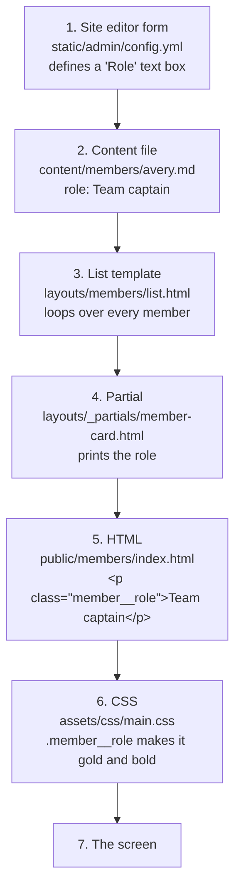

# 7. Follow one field all the way through

**You'll learn:** how the pieces from the last few chapters connect, by tracing one piece of information, a member's role, from the moment someone types it to the moment it appears on screen.

This is the most useful chapter in the guide. Once you can trace one field, you can trace any of them, and you'll know exactly which files to change to add a new one.

## The journey



Let's look at each step.

### Step 1: the editor's form field

When a coach opens a member in the site editor, they see a box labelled **Role**. That box exists because of this line in `static/admin/config.yml`, inside the `members` collection:

<!-- source: static/admin/config.yml -->
```yaml
      - { name: role, label: Role, hint: "e.g. Team captain, Programming lead, Driver", widget: string, required: false }
```

| Part | Meaning |
| --- | --- |
| `name: role` | The front matter field this box reads and writes. **This must match what the template uses** |
| `label: Role` | What the editor shows above the box |
| `hint:` | The grey help text under it |
| `widget: string` | A one-line text box |
| `required: false` | It's OK to leave it empty |

### Step 2: the content file

When they press Save, the editor writes the value into the member's file as front matter. In `content/members/avery.md`:

<!-- source: content/members/avery.md -->
```yaml
title: Avery
role: Team captain
```

You could also type that line by hand in VS Code. The editor and VS Code are just two ways of changing the same file.

### Step 3: the list template finds the member

When Hugo builds `/members/`, it picks `layouts/members/list.html` ([chapter 5](05-how-hugo-builds-a-page.md)). That template finds the students and loops over them:

<!-- source: themes/ver37974/layouts/members/list.html -->
```go-html-template
  {{ $students := where .Pages "Params.member_type" "ne" "mentor" }}
```

<!-- source: themes/ver37974/layouts/members/list.html -->
```go-html-template
      {{ range .ByWeight }}{{ partial "member-card.html" . }}{{ end }}
```

For Avery, the `partial` gets Avery's page as its dot.

### Step 4: the partial prints it

In `layouts/_partials/member-card.html`:

<!-- source: themes/ver37974/layouts/_partials/member-card.html -->
```go-html-template
  {{ with .Params.role }}<p class="member__role">{{ . }}</p>{{ end }}
```

`.Params.role` is `Team captain`. Because it isn't empty, `with` runs, the dot becomes `Team captain`, and the paragraph is printed.

### Step 5: the HTML

Run `hugo` and open `public/members/index.html`. Search for "Team captain":

```html
<p class="member__role">Team captain</p>
```

That's what the browser downloads. The template code is gone: only the result is left.

### Step 6: the CSS styles it

The browser sees `class="member__role"` and looks for matching CSS rules. In `themes/ver37974/assets/css/main.css`:

<!-- source: themes/ver37974/assets/css/main.css -->
```css
.member__role { color: var(--wheat); font-weight: 700; margin: 0; font-size: 0.95rem; }
```

So the role is light gold (`--wheat`), bold, with no space around it, and slightly smaller than body text. [Chapter 8](08-css.md) explains `var(--wheat)`.

### Step 7: on screen

The role appears in gold under Avery's name.

## The lesson: a field lives in up to five places

Adding or changing a field can mean touching:

| Place | File | Needed when |
| --- | --- | --- |
| The editor | `static/admin/config.yml` | People should be able to edit it in the site editor |
| The content | `content/.../*.md` | Always: that's where the value is stored |
| The template | `themes/ver37974/layouts/...` | Always: otherwise nothing shows it |
| The styles | `themes/ver37974/assets/css/main.css` | It needs its own look |
| The starter file | `archetypes/...` | New files made with `hugo new content` should include it |

And one more: **this guide**. Add the field to the reference tables in [chapter 4](04-content.md#field-reference-what-each-section-uses).

The most common mistake is changing one place and forgetting another. For example, adding a field to the editor but not the template: people fill it in, and nothing happens. Or renaming a field in the template but not in `config.yml`: the editor keeps writing the old name, and the template looks for the new one.

## Try it: trace a different field

Pick one and trace it through every step, writing down the file and line at each step:

1. An event's `result` (hint: it appears in two templates)
2. A sponsor's `tier` (hint: it's compared against `data/sponsorship.yaml`)
3. The robot season's `versions` (hint: `robot/single.html` uses `collections.Reverse`. Why?)

Then try [Recipe 3](13-recipes.md#recipe-3-add-a-new-field-to-members), which adds a brand-new field to members.

## Check your understanding

1. Someone adds a "Pronouns" box to the members collection in `config.yml`. Coaches fill it in for everyone. Nothing appears on the site. Why?
2. You rename `role` to `position` in `member-card.html`, but nowhere else. What happens to the site? What happens next time a coach edits a member?
3. Which file decides that the role is gold?

<details>
<summary>Answers</summary>

1. The template (`member-card.html`) doesn't use the new field. The editor saves it into the content files, but no template prints it.
2. All the roles disappear from the site, because the files still say `role:` and the template now looks for `position`. The editor still shows and saves `role`, so the problem doesn't fix itself. You'd need to rename it in `config.yml` and in every member file too, or change the template back.
3. `themes/ver37974/assets/css/main.css`, in the `.member__role` rule.

**Try it, question 3:** versions are written oldest first in the file (so adding a new one goes at the bottom), but the page shows the newest first. `collections.Reverse` flips the list.

</details>

Next: [8. CSS: how the site looks](08-css.md)
