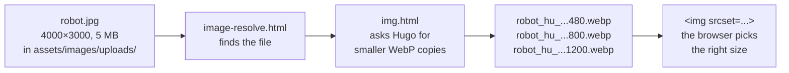

# 10. Images, fonts and other assets

**You'll learn:** the difference between `static/` and `assets/`, how Hugo resizes images automatically, what `minify` and `fingerprint` do to our CSS and JavaScript, and why the fonts are stored with the site.

## Two kinds of files: `static/` and `assets/`

| | `static/` | `assets/` |
| --- | --- | --- |
| What Hugo does | Copies every file into `public/`, untouched | Nothing, until a template asks for the file |
| Published? | Always | Only if a template uses it |
| Can be processed? | No | Yes: resized, converted, minified, combined |
| Address | Same path: `static/admin/config.yml` → `/admin/config.yml` | Whatever the processing produces |
| Good for | Files that must stay exactly as they are: the editor, icons, fonts | Photos, CSS, JavaScript |

Both exist in the project *and* in the theme. Remember the rule from [chapter 3](03-project-tour.md#the-one-rule-your-project-beats-the-theme): if the same path is in both, the project wins.

## How a photo gets onto a page

Say a coach uploads `robot.jpg` (4000 × 3000 pixels, 5 MB) as a blog post's cover. Showing that file directly would be slow: a phone would download 5 MB to show a picture 400 pixels wide. So instead:



### Step 1: find the image (`image-resolve.html`)

Front matter gives a path like `/images/uploads/robot.jpg`. `image-resolve.html` looks for that file in two places, in order:

1. **The page's own folder**, if the page is a bundle. That's how a gallery album finds `photo-1.jpg`.
2. **`assets/`**, at `assets/images/uploads/robot.jpg`. That's where the site editor saves uploads.

It returns the file as a **resource**, which is Hugo's word for a file it can work with. If it finds nothing, it returns an empty string, and `img.html` falls back to a plain `` tag with the path as written.

### Step 2: make resized copies (`img.html`)

Hugo has three main ways to resize an image:

| Method | What it does | We use it for |
| --- | --- | --- |
| `.Resize "800x"` | Scale to 800 pixels wide, keep the shape | Blog covers, images in posts |
| `.Fill "320x320 Smart"` | Scale and **crop** to exactly 320 × 320. `Smart` crops around the most interesting part | Member photos, card images, album thumbnails |
| `.Fit "1800x1800"` | Scale down to fit inside 1800 × 1800, keep the shape | The large photo in the lightbox |

Adding `webp` converts the copy to **WebP**, a format that's usually about a third smaller than JPEG at the same quality. (That's why the site needs Hugo's *extended* edition.)

For cropped images, `img.html` makes two sizes, normal and double, for high-resolution screens:

<!-- source: themes/ver37974/layouts/_partials/img.html -->
```go-html-template
    {{- $one := $r.Fill (printf "%dx%d webp Smart" $fw $fh) -}}
    {{- $two := $r.Fill (printf "%dx%d webp Smart" (mul $fw 2) (mul $fh 2)) -}}
    
```

For images that aren't cropped, it makes up to four widths (480, 800, 1200 and 1600 pixels, but never bigger than the original) and lists them all in `srcset`. The browser picks the smallest one that looks sharp on that screen. You don't have to do anything: this all happens when you write `{{ partial "img.html" ... }}`.

The other attributes matter too:

| Attribute | Why |
| --- | --- |
| `width` and `height` | The browser reserves space before the image loads, so the page doesn't jump around |
| `loading="lazy"` | Don't download it until the visitor scrolls near it |
| `decoding="async"` | Don't hold up the rest of the page while decoding it |
| `alt` | The description screen readers read aloud. **Always describe the photo** |

SVG drawings and animated GIFs can't be resized this way, so `image-processable.html` checks the file type first, and those are used as they are.

### Where the resized copies go

Hugo saves its resized copies in `resources/_gen/images/` so it doesn't redo them every build. That folder is in `.gitignore`. If images look wrong or old, deleting `resources/` forces Hugo to remake them.

In the finished site, the copies have names like `robot_hu_4c702ec5a7945ef9.webp`. The long code changes whenever the original or the settings change.

### Images inside Markdown

When someone writes `` in a post, Hugo would normally output a plain ``. Our **render hook** `layouts/_markup/render-image.html` intercepts it and uses `img.html` instead, so those images get resized too. If the Markdown has a title, like ``, the hook adds it as a caption under the image.

### Quality and resizing settings

In `hugo.toml`:

<!-- source: hugo.toml -->
```toml
[imaging]
  quality = 82
  resampleFilter = "Lanczos"
```

`quality` is how much to compress (out of 100: lower is smaller but blurrier). `Lanczos` is a resizing method that keeps edges sharp.

## Hugo Pipes: processing CSS and JavaScript

**Hugo Pipes** is Hugo's name for processing a file from `assets/` through a chain of functions. In `head.html`:

<!-- source: themes/ver37974/layouts/_partials/head.html -->
```go-html-template
{{ $css := resources.Get "css/main.css" | minify | fingerprint }}
<link rel="stylesheet" href="{{ $css.RelPermalink }}" integrity="{{ $css.Data.Integrity }}">
```

Read it as a recipe: get `css/main.css`, then shrink it, then fingerprint it.

### `minify`

Removes everything the browser doesn't need: comments, line breaks and spaces. Our CSS goes from about 34 KB to about 28 KB. That's why we can write as many comments as we like in the source: visitors never download them. You keep editing the readable version; visitors download the small one.

### `fingerprint`

Adds a code to the file name, made from the file's contents: `main.min.3f9a...css`. Why?

Browsers **cache** files: they keep a copy so they don't download it again on every page. That's great for speed, but if you change the CSS and the file name stays the same, some visitors keep seeing the old styles for days. With a fingerprint, any change to the CSS changes the name, so browsers know it's a new file. Unchanged files keep their name and stay cached. This trick is called **cache busting**.

### `integrity`

`$css.Data.Integrity` is a code (a **hash**) calculated from the file's exact contents. The browser calculates the same code when it downloads the file, and refuses to use the file if they don't match. That protects visitors if the file were ever tampered with on the way.

The JavaScript goes through exactly the same steps in `baseof.html`.

## Fonts

The two typefaces are stored in `themes/ver37974/static/fonts/` as `.woff2` files (the most compressed web font format) and loaded with `@font-face` rules at the top of `main.css`:

<!-- source: themes/ver37974/assets/css/main.css -->
```css
@font-face { font-family: "Big Shoulders Display"; font-weight: 800; font-style: normal; font-display: swap; src: url("../fonts/big-shoulders-display-latin-800-normal.woff2") format("woff2"); }
```

Each rule says: "when CSS asks for Big Shoulders Display at weight 800, use this file." `font-display: swap` shows the text in a fallback font straight away and swaps in our font when it arrives, so nobody stares at a blank page.

**Why not load them from Google Fonts like many sites do?** Because then every visitor's browser would contact Google on every page. Storing them ourselves is faster (one less server to talk to) and more private, which matters on a site about young people. Both fonts use the SIL Open Font License, which allows this. The licences are in the same folder.

Only the weights we use are included: 700 and 800 for headings; 400, 400 italic and 700 for body text. Each extra weight is another file to download.

## The logo files

| File | Size | Used for |
| --- | --- | --- |
| `logo.png` | 423 × 423, transparent | Header, footer, placeholders, the 404 page |
| `logo-512.png` | 512 × 512, transparent | The home page hero |
| `logo-on-navy.png` | 557 × 557 | The original artwork, on its navy square |
| `favicon-32.png` | 32 × 32 | Browser tabs |
| `icon-192.png`, `apple-touch-icon.png` | 192 and 180 square | Phone home screens |
| `og-default.png` | 1200 × 630 | The preview picture when a link is shared, if the page has no cover |

The transparent versions were made by removing the logo's exact navy background colour, pixel by pixel. If the logo changes, all of these need remaking.

## Guidelines for uploading images

- **Photos:** JPEG, ideally under 5 MB. Hugo makes the small versions, so don't shrink them yourself.
- **Logos:** SVG if the sponsor has one, otherwise PNG with a transparent background.
- **Names:** lowercase with hyphens, like `qualifier-pit-2026.jpg`. No spaces.
- **Always write a description** (alt text) that says what's in the picture: "Mateo and Eli lifting the robot onto the field", not "photo".
- **Consent:** only upload photos where every identifiable student has media consent ([chapter 11](11-site-editor.md#rules-for-posting)).

## Try it

1. Run `hugo`, then look in `public/images/uploads/`. How many files came from `robot-v2.jpg`? Why that many? (Hint: search the templates for `.Params.image`, and remember `head.html` makes a share image.)
2. Open a blog post in your browser, right-click the cover image and choose **Inspect**. Look at the `srcset`. Then, in the developer tools' **Network** tab, reload and check which size the browser actually downloaded.
3. Change `quality = 82` to `quality = 20`, delete the `resources/` folder, and run `hugo server`. What do the photos look like? Change it back.
4. Look at the `<link rel="stylesheet">` in a page's source (**Ctrl+U**). Change one colour in `main.css`, and look again. What changed?

## Check your understanding

1. You put `brochure.pdf` in `assets/`. No template uses it. Is it on the website?
2. Why do resized images use WebP?
3. What problem does fingerprinting solve?
4. Why aren't the fonts loaded from Google?
5. Why do `` tags include `width` and `height`?

<details>
<summary>Answers</summary>

1. No. Files in `assets/` are only published when a template uses them. Put it in `static/` instead, and it'll be at `/brochure.pdf`.
2. WebP files are usually much smaller than JPEGs at the same quality, so pages load faster, especially on phones.
3. Browser caching: without it, visitors might keep using an old copy of the CSS or JavaScript after we change it. A new fingerprint means a new file name, so browsers fetch the new version.
4. Privacy and speed: visitors' browsers don't have to contact Google, and there's one less server to wait for.
5. So the browser can reserve the right amount of space before the image downloads, and the page doesn't jump around as images appear.

**Try it, question 4:** the file name's fingerprint and the `integrity` code both changed, because the file's contents changed.

</details>

Next: [11. The site editor (Sveltia CMS)](11-site-editor.md)
