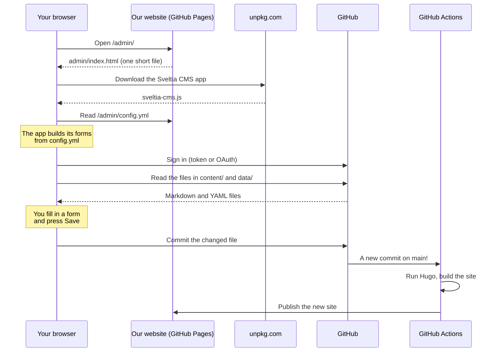

# 11. The site editor (Sveltia CMS)

**You'll learn:** how to use the site editor to post and update content, the rules for what we post, how the editor actually works behind the scenes, and how to change what it offers.

The first half of this chapter is for everyone who posts content. The second half, from [How it works](#how-it-works), is for anyone who wants to understand or change the editor.

## What it is

The site editor is at **`/admin/`** on our website (there's also a "Site editor" link in the footer). It gives you forms to fill in, like "Title", "Date" and "Photo", instead of making you edit files.

It's built with [Sveltia CMS](https://sveltiacms.app/). A **CMS** (content management system) is any tool for editing a website's content without editing code. Sveltia is a particular kind called a **Git-based CMS**: instead of storing your content in a database, it saves it as files in our GitHub repository, exactly as if you'd edited them in VS Code.

## Signing in

You need a GitHub account that's been added to the repository. Ask the website lead.

There are two ways to sign in, depending on how the team set it up:

- **"Sign in with GitHub"**: if this button is there, click it and approve. That's it.
- **"Sign in with token"**: you'll need a **personal access token**, which is like a password made just for one tool. To make one:
  1. On GitHub, go to your profile picture > **Settings** > **Developer settings** > **Personal access tokens** > **Fine-grained tokens** > **Generate new token**.
  2. Give it a name like "Team website editor" and an expiry date (the end of the season is good).
  3. Under **Repository access**, choose **Only select repositories** and pick the website repository.
  4. Under **Permissions** > **Repository permissions**, set **Contents** to **Read and write**.
  5. Generate it, copy it, and paste it into the editor.

**Treat a token like a password.** Anyone who has it can change the website. Don't share it, don't post it anywhere, and if you think someone else has seen it, delete it on GitHub and make a new one. The editor remembers your token in your browser, so **sign out when you use a shared computer**.

## Finding your way around

- **On the left:** the kinds of content, called **collections**: Announcements, Blog, Members, Robot seasons, Engineering portfolio, Outreach, Events, Gallery, Sponsors, and Pages (the one-off pages like Home and About).
- **In the middle:** the entries in the collection you picked, with a button to create a new one.
- **When you open an entry:** the form, and a preview of the text.

## Everyday tasks

### Post an announcement

1. **Announcements** > create a new entry.
2. Fill in **Title**, **Date** and a **One-line summary**. Add **Details** if needed.
3. Turn on **Pin to the top** for anything everyone must see, like a deadline. Turn it off again when it's no longer urgent: a pinned announcement also replaces the "Latest announcement" on the home page.
4. Save.

### Write a blog post

Blog posts are for families and sponsors: what we built, how a competition went, thanks to a sponsor.

1. **Blog** > create a new entry.
2. Fill in the title, date, your first name and a summary.
3. Add a **Cover image** and its **description** (what's in the photo).
4. Write the post in the **Post** box. The toolbar has headings, bold, lists and links.
5. Add **Tags** like `build`, `competition` or `sponsors`.
6. Save.

### Add an engineering journal entry

1. **Engineering portfolio** > create a new entry.
2. Pick the **Subsystem**, and list every author's first name.
3. The **Entry** box starts with five headings: Goal, What we tried, Results, Decision, Next steps. Fill each one in. Include numbers from your tests: judges look for evidence.
4. Save.

### Add or update a member

1. **Members** > create a new entry (or open an existing one).
2. **First name only.** Pick **Student** or **Coach or mentor**.
3. Add their role, subteams, grade and a one-line bio.
4. **Photo:** you can upload one, but it only appears on the site if **Parent has given media consent** is on. Only turn that on if a signed media release is on file. Ask a coach if you're not sure.
5. **Sort order:** lower numbers show first. The captain might be 10, leads 20 to 50, and everyone else 60.

### Make a photo album

1. **Gallery** > create a new entry.
2. Give it a name, date and event.
3. Under **Photos**, add each photo with a short caption. They show in this order.
4. Under **YouTube videos**, paste links to any videos.
5. Save. The photos are stored in the album's own folder.

### Add an event, then its result

1. **Events** > create a new entry.
2. Fill in the name, type, location, **Starts** and **Ends**.
3. **Never enter a host family's address.** Only public venues get a street address.
4. After the event, open it again and fill in **Our result** (like "Ranked 5th of 24, Inspire Award finalist") and the **Photo album link**.

Events move from "Coming up" to "Past events" by themselves the day after they end.

### Add a sponsor

1. **Sponsors** > create a new entry.
2. Fill in the name, **Tier**, website and a thank-you message saying what their support made possible.
3. Upload their **Logo**. A PNG with a transparent background, or an SVG, looks best on the white tile.
4. When they stop sponsoring, turn off **Current sponsor**. They move to the "past sponsors" line instead of disappearing.

### Change the home page, About page or sponsorship levels

These are under **Pages**. **Sponsorship tiers and budget** controls the tiers, amounts, benefits, the season budget and the "How to sponsor us" steps.

## After you press Save

Your change is saved to GitHub immediately. The website takes **about 1 to 2 minutes** to update, because GitHub has to rebuild it. Refresh the page after that.

If it still hasn't changed after five minutes, something went wrong with the build. Your change is safe on GitHub, but the website lead needs to look at it. They can see what happened in the repository's **Actions** tab ([chapter 12](12-publishing.md)).

## Fixing a mistake

- **Small mistake:** open the entry, fix it, and save again.
- **Deleted something by accident, or need an old version back:** every save is a commit, so nothing is ever really lost. On GitHub, open the file and click **History** to see every version. The website lead can restore any of them.

## Rules for posting

Most of our members are under 18. These rules protect them, and they apply to everyone, including coaches.

1. **First names only** for students, everywhere: member list, blog posts, captions, journal authors.
2. **No photo of a student without media consent.** If a photo includes someone without consent, don't post it.
3. **No addresses of homes.** We meet in host homes. Never post a host's address, or anything that would let someone work it out.
4. **No personal contact details** for students: no phone numbers, emails or social media handles.
5. **No school names attached to a student**, like "Avery from (school name)".
6. **Describe every image** in its description or caption.
7. **Be accurate.** Results, awards and numbers should be checkable. Judges and sponsors read this site.
8. **When in doubt, ask a coach before posting.**

---

## How it works

Here's the interesting part. Our site has no server program and no database ([chapter 1](01-how-the-website-works.md)), so how can a website have a login and a Save button?

The answer: **the editor is a program that runs entirely in your browser, and talks directly to GitHub.**



Step by step:

1. **Loading the editor.** `/admin/` is a normal file from `static/admin/index.html`. It's tiny: it just loads the Sveltia app from `unpkg.com`, a service that hosts code packages.

<!-- source: static/admin/index.html -->
```html
  <script src="https://unpkg.com/@sveltia/cms/dist/sveltia-cms.js"></script>
```

2. **Reading the setup.** The app looks for `config.yml` next to `index.html`. That file tells it which repository to use, what collections exist, and which fields each has. **Everything you see in the editor comes from `config.yml`.**

3. **Signing in.** The app needs permission to read and change our repository, so it asks GitHub for an access token. You either paste one in, or use "Sign in with GitHub" ([below](#why-sign-in-with-github-needs-a-small-server)).

4. **Reading content.** Using GitHub's API (a way for programs to talk to GitHub), the app downloads the files in each collection's folder. It reads each file's front matter and fills in the form fields.

5. **Saving.** When you press Save, the app turns the form back into a file (YAML front matter plus the Markdown body) and commits it to the `main` branch, with you as the author. It's exactly the same as someone editing the file in VS Code and running `git commit` and `git push`.

6. **Publishing.** The new commit starts the deploy workflow, which rebuilds and publishes the site ([chapter 12](12-publishing.md)).

Notice what's **not** in the picture: a Sveltia server holding our content. Your content only ever travels between your browser and GitHub. `unpkg.com` only provides the app's code.

### Why this design is a good fit for us

| | Traditional CMS (e.g. WordPress) | Git-based CMS (Sveltia) |
| --- | --- | --- |
| Where content lives | A database on a server | Files in our Git repository |
| What we have to run | A server, a database, updates | Nothing. GitHub does the hosting |
| Cost | Hosting fees | Free |
| History and undo | Sometimes, limited | Every save is a commit, forever |
| Can developers edit the same content in code? | Not easily | Yes: it's the same files |
| Works with a static site | No | Yes |

The trade-off: changes take a minute or two to appear, because the site has to rebuild.

### Uploads: where images go

`config.yml` sets where uploaded images are saved:

<!-- source: static/admin/config.yml -->
```yaml
media_folder: assets/images/uploads
public_folder: /images/uploads
```

- `media_folder` is where the file is **saved in the repository**: `assets/images/uploads/`. That's in `assets/`, so Hugo can resize it ([chapter 10](10-images-and-assets.md)).
- `public_folder` is **what gets written into the front matter**: `/images/uploads/robot.jpg`. Our `image-resolve.html` partial knows to look for that path in `assets/`.

Gallery albums are different. Their collection has its own setting:

<!-- source: static/admin/config.yml -->
```yaml
    path: "{{slug}}/index"
    media_folder: ""
    public_folder: ""
```

`path: "{{slug}}/index"` makes each album a folder with an `index.md` (a page bundle, [chapter 4](04-content.md#page-bundles-a-page-with-its-own-files)). `media_folder: ""` means "save uploads in the same folder as the entry", so an album's photos live with the album.

### Why "Sign in with GitHub" needs a small server

Signing in with a button uses a system called **OAuth**: GitHub asks you "Do you want to let this app access your repositories?", and if you say yes, gives the app a token.

To do that, GitHub has to be sure the request is really from our app. It checks a **client secret**: a password that only our app should know. But anything in a browser app can be read by anyone who opens the browser's developer tools. A browser app can't keep a secret.

So the secret is kept on a tiny server, the **Sveltia CMS Authenticator**, which runs for free on Cloudflare Workers. It handles just that one step and passes the token back to the editor. That's what `base_url` in `config.yml` points to.

The token sign-in method skips all of that: you create the token yourself on GitHub and paste it in. It's simpler to set up, but each person has to make their own token.

## How `config.yml` is put together

Open `static/admin/config.yml`. It has three parts.

### 1. Where the content lives

<!-- source: static/admin/config.yml -->
```yaml
backend:
  name: github
  repo: YOUR-GITHUB-ACCOUNT/YOUR-REPO   # change this
  branch: main
```

Which service (`github`), which repository, and which branch to save to.

### 2. Shared settings

`media_folder` and `public_folder` (above), the site's address (`site_url`, used for the "view site" link), and `slug` rules, which turn a title like "Kickoff: Reading the Manual!" into a safe file name like `kickoff-reading-the-manual`.

### 3. Collections

Each collection is one kind of content. There are two types:

- **Folder collections** (most of ours) manage *every file in a folder*, and let you create new ones. Each has `folder:`, like `folder: content/blog`.
- **File collections** manage *specific files*, like the home page. Ours are under `pages`, and each has `file:`, like `file: content/_index.md`.

Here's part of the members collection:

<!-- source: static/admin/config.yml -->
```yaml
  - name: members
    label: Members
    label_singular: Member
    description: First names only for students. Turn on photo consent only when a parent has signed the media release.
    folder: content/members
    create: true
    format: yaml-frontmatter
    slug: "{{slug}}"
    summary: "{{title}}: {{role}}"
    sortable_fields: [weight, title]
```

| Setting | Meaning |
| --- | --- |
| `name` | An internal name, never shown |
| `label`, `label_singular` | What the editor calls it: "Members", "New Member" |
| `description` | Help text at the top of the collection |
| `folder` | Which folder's files to manage |
| `create: true` | Allow new entries |
| `format: yaml-frontmatter` | Files are YAML front matter plus Markdown, like all our content |
| `slug` | How to name new files. `{{slug}}` means "made from the title" |
| `summary` | How each entry appears in the list: "Avery: Team captain" |
| `sortable_fields` | Which fields you can sort the list by |

Then comes `fields:`, the form. Each field has a `name` (the front matter key), a `label` (what you see) and a `widget` (what kind of input):

| Widget | Gives you | Saves as | Example in our config |
| --- | --- | --- | --- |
| `string` | One line of text | Text | Member's role |
| `text` | Several lines of plain text | Text | Summaries |
| `markdown` | A rich text editor with a toolbar | Markdown (the body) | Blog post |
| `number` | A number box | A number | Grade, hours |
| `boolean` | An on/off switch | `true` or `false` | Photo consent, pinned |
| `datetime` | A date (and time) picker | A date | Event start |
| `select` | A drop-down of fixed choices | One choice, or a list with `multiple: true` | Subsystem, subteams |
| `image` | An upload button | A path to the file | Cover image |
| `list` | Repeatable items | A list | Photos, versions, specs |
| `object` | A group of fields | A group | The home page hero |
| `hidden` | Nothing visible | A fixed value | The home page's title |

Two special names: **`title`** is the entry's title, and **`body`** is the Markdown after the front matter.

`required: false` makes a field optional. `default:` fills it in for new entries. `hint:` adds help text.

## Changing the editor

The golden rule from [chapter 7](07-follow-a-field.md): **a field in the editor does nothing unless a template uses it, and a template field can't be edited unless it's in the editor.** Change both, and use the same `name`.

[Recipe 3](13-recipes.md#recipe-3-add-a-new-field-to-members) walks through adding a field to both.

### Testing editor changes on your own computer

You don't want to commit a broken `config.yml` and find out from a coach. Sveltia can work on the files on your computer instead of GitHub:

1. Use **Chrome or Edge** (this feature uses a browser ability, the File System Access API, that Firefox and Safari don't have).
2. Run `hugo server --disableLiveReload` in the project folder. (Live reload would reload the editor every time it saves a file, which can interrupt it.)
3. Open http://localhost:1313/admin/ and choose **Work with Local Repository**.
4. Select the project folder, and allow access.
5. Edit an entry and save. The editor changes the file on your computer, not on GitHub. Run `git diff` to see exactly what it wrote, and refresh the site's tab to see the result.

This is also the best way to learn what the editor does: make a change in the form, then read the file it wrote.

> **Note:** the editor's code still downloads from `unpkg.com`, so you need to be online.

### The editor and Git, together

Because the editor commits to `main`, someone using the editor and someone coding can change things at the same time. That's why the rule in [chapter 2](02-setting-up-your-computer.md#always-pull-before-you-start) is **always `git pull` before you start coding**.

The editor always loads the newest files from GitHub when you open it, so editor users don't need to do anything special. But if two people edit *the same entry* at the same time, the second save may be refused. Reload the editor and make the change again.

## Contact forms

The contact and sponsorship forms aren't part of the site editor, but they have the same problem to solve: a static site can't receive anything. When `formAction` is empty in `hugo.toml`, the forms are replaced with email links. To make them real forms, sign up for a form service such as [Formspree](https://formspree.io/), create a form, and paste the address it gives you into `formAction`. The service receives the message and emails it to the team. The form includes a hidden "honeypot" box: people can't see it, but spam robots fill it in, which tells the service to throw the message away.

## Try it

1. Sign in to the editor, open any member, and change nothing. Look at the **History** of that file on GitHub. There's no new commit, because nothing changed.
2. Using the local workflow above, create an announcement in the editor. Then open the new file in VS Code. Which form field became which line?
3. In `config.yml`, find the `hint` for the event `address` field. Why is it there?

## Check your understanding

1. When you press Save, where does your change go first?
2. Why does the site take a minute or two to update after you save?
3. Why can't the client secret for "Sign in with GitHub" be stored in the editor app itself?
4. You add a `pronouns` field to the members collection in `config.yml`. What else must change before pronouns appear on the site?
5. An uploaded image is saved at `assets/images/uploads/qualifier.jpg`, but the front matter says `/images/uploads/qualifier.jpg`. Why the difference?

<details>
<summary>Answers</summary>

1. Into a commit on the `main` branch of our GitHub repository, made directly from your browser.
2. The commit has to trigger GitHub Actions, which runs Hugo to rebuild the whole site and then publishes it.
3. Anything in a browser app can be read by anyone using developer tools, so it wouldn't be secret. A small server (the Sveltia CMS Authenticator) keeps it instead.
4. A template, `member-card.html`, must print `.Params.pronouns`. Optionally, add a CSS rule to style it, add it to `archetypes/members.md`, and add it to chapter 4's field reference.
5. `media_folder` is where the file is stored in the repository. `public_folder` is the path written into the front matter, which is the path the site uses. `image-resolve.html` looks that path up in `assets/`.

</details>

Next: [12. Publishing with GitHub Actions](12-publishing.md)
